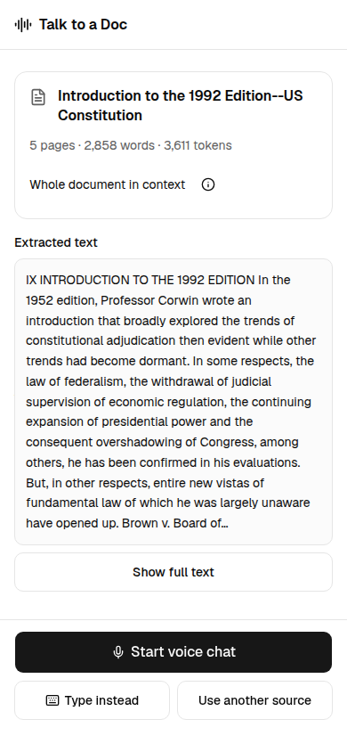
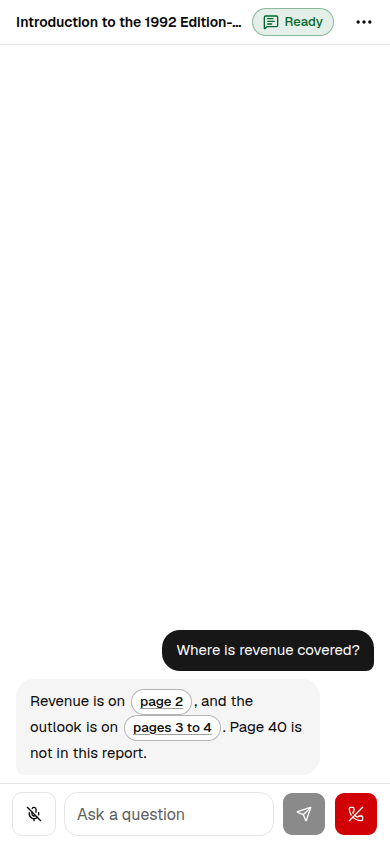
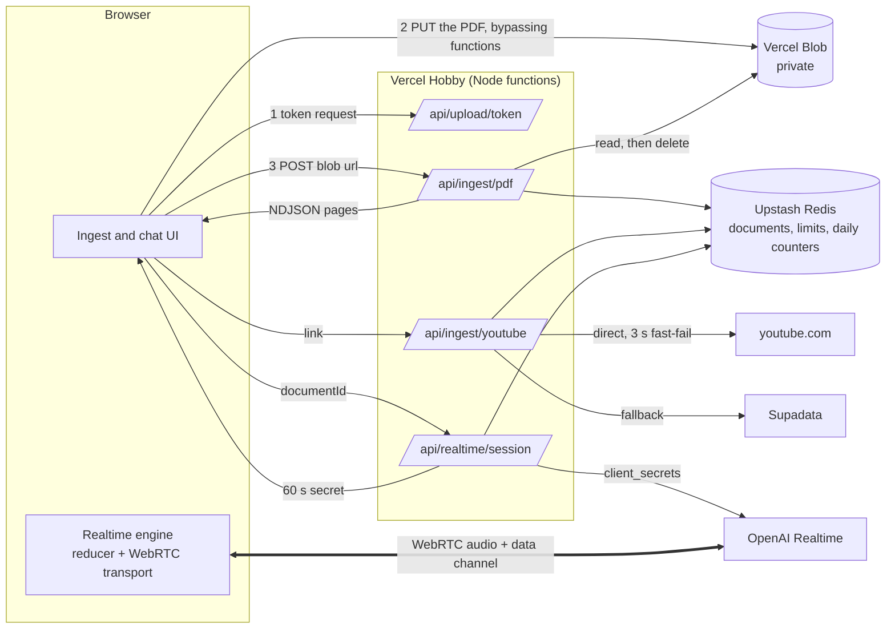

# Talk to a Document or YouTube Video

Upload a PDF or paste a YouTube link, read the extracted text, and talk about it out loud with the OpenAI Realtime API, from a phone.

- **Live app:** https://talk-to-doc-seven.vercel.app/
- **Video walkthrough:** https://youtu.be/9G_xZQpekSs
- **CI:** [](https://github.com/Otm02/talk-to-doc/actions/workflows/ci.yml)

|                                    Document ready (390 px)                                    |                        Chat with grounding chips (390 px)                        |
| :-------------------------------------------------------------------------------------------: | :------------------------------------------------------------------------------: |
|  |  |

The second screenshot is the mock transport playing a scripted answer (no OpenAI call was made to take it), so the answer's words are not about the sample document. The chips and layout are the real UI.

**What it does**

- PDF (up to 25 MB, 2,000 pages) or YouTube link in; the full extracted text is shown in a full-screen sheet with search.
- Live voice conversation over WebRTC, with interruption (talk over the answer and it stops), live captions of both sides, and a typed fallback when there is no microphone.
- **Grounding chips:** when an answer says "page 12" or "[04:05]", it becomes a chip. Tap it and the text sheet opens at that page or timestamp, highlighted.
- **Transcript export:** copy or download the chat as Markdown, with the source and date in the file.
- Works on a flaky phone connection: reconnects with the transcript kept, honest Offline and Cooldown states, a compact layout when the keyboard is open.
- Runs on free tiers only: Vercel Hobby, Vercel Blob, Upstash Redis.

## 1. Quick start

**Prerequisites:** Node 24 (CI uses 24), pnpm 12, git. An OpenAI API key only if you want a live voice session. Everything else (PDF upload, YouTube, the text, all tests) works without one.

```bash
git clone https://github.com/Otm02/talk-to-doc.git
cd talk-to-doc
pnpm install
cp .env.example .env.local   # optional; the defaults run without it
pnpm dev
```

Open http://localhost:3000 at about 390x844 (browser devtools device mode is fine). `GET /api/health` shows the version, upload mode and state backend.

### `.env.local`

Everything is validated lazily at request time in `src/server/env.ts`, so builds and CI need none of it. Unset or empty means the default.

| Variable                            | Required                | Default                            | Purpose                                                                                                            |
| ----------------------------------- | ----------------------- | ---------------------------------- | ------------------------------------------------------------------------------------------------------------------ |
| `OPENAI_API_KEY`                    | For voice or text chat  | none                               | Mints the short-lived Realtime client secret. Never sent to the browser                                            |
| `REALTIME_MODEL`                    | No                      | `gpt-realtime-2.1-mini`            | `gpt-realtime-2.1-mini` or `gpt-realtime-2.1`                                                                      |
| `REALTIME_VOICE`                    | No                      | `marin`                            | Output voice                                                                                                       |
| `REALTIME_REASONING_EFFORT`         | No                      | `low`                              | `minimal`, `low`, `medium`, `high`                                                                                 |
| `CONTEXT_TOKEN_BUDGET`              | No                      | `8000`                             | Max document tokens given to the model (1000 to 60000)                                                             |
| `MAX_SESSION_MINUTES`               | No                      | `5`                                | Length of one chat (1 to 30)                                                                                       |
| `DOC_TTL_MINUTES`                   | No                      | `120`                              | How long an extracted document is kept                                                                             |
| `VOICE_ENABLED`                     | No                      | `true`                             | Kill switch for chats                                                                                              |
| `DAILY_SESSION_CAP`                 | No                      | `40`                               | Chat starts per UTC day, all visitors together                                                                     |
| `UPLOAD_MODE`                       | No                      | `direct` locally, `blob` on Vercel | `direct` posts the PDF to the route; `blob` uploads from the browser to Vercel Blob. `direct` is refused on Vercel |
| `BLOB_READ_WRITE_TOKEN`             | With `UPLOAD_MODE=blob` | none                               | Set when you connect a Blob store                                                                                  |
| `SUPADATA_API_KEY`                  | No                      | none                               | Enables the YouTube fallback provider                                                                              |
| `UPSTASH_REDIS_REST_URL` / `_TOKEN` | On Vercel               | none                               | Shared state. `KV_REST_API_URL` / `KV_REST_API_TOKEN` also work. Empty means in-memory                             |
| `IP_HASH_SALT`                      | On Vercel               | random per run                     | 16+ characters; keys the hash behind per-client limits                                                             |
| `CRON_SECRET`                       | On Vercel               | none                               | Bearer token for the daily cleanup route. Unset means the route refuses everyone                                   |
| `NEXT_PUBLIC_REALTIME_TRANSPORT`    | No                      | `webrtc`                           | `mock` swaps OpenAI for a scripted server (tests, screenshots)                                                     |

### Testing on a phone

The microphone and WebRTC need a secure context, so plain `http://<laptop-ip>:3000` will not work for voice. Three ways that do:

1. **Chrome port forwarding (Android, USB).** Turn on USB debugging, plug the phone in, open `chrome://inspect/#devices` on the laptop, tick "Discover USB devices", click "Port forwarding", add `3000` to `localhost:3000`, then open `http://localhost:3000` on the phone. `localhost` counts as secure, and the page's devtools open on the laptop.
2. **cloudflared.** `cloudflared tunnel --url http://localhost:3000` prints an `https://….trycloudflare.com` URL to open on any phone. `next.config.ts` already allows that host in dev.
3. **A Vercel preview.** Push a branch; the preview URL is HTTPS. Previews sit behind Vercel Authentication, so log in on the phone first.

### Other commands

| Command                       | Does                                                                                |
| ----------------------------- | ----------------------------------------------------------------------------------- |
| `pnpm check`                  | Lint, Prettier check, `next typegen` then `tsc`, unit tests with the coverage gates |
| `pnpm test`                   | Vitest                                                                              |
| `pnpm test:e2e`               | Playwright at 390x844 on Chromium and WebKit, mock transport                        |
| `pnpm test:live`              | The one test that calls OpenAI. By hand only (see Testing)                          |
| `pnpm build` / `pnpm start`   | Production build and server                                                         |
| `pnpm smoke <url>`            | Deploy smoke test (see below)                                                       |
| `pnpm fixtures`, `pnpm icons` | Regenerate the test PDFs; redraw the app icons                                      |

Try the ingest routes without the UI:

```bash
curl -N -F file=@some.pdf localhost:3000/api/ingest/pdf
curl -N -X POST localhost:3000/api/ingest/youtube \
  -H 'content-type: application/json' -d '{"url":"https://youtu.be/UF8uR6Z6KLc"}'
```

Both answer with newline-delimited JSON: a metadata line, one line per page or ~30 second paragraph, then a `done` line. Refusals come back as JSON with an HTTP status.

Smoke test a deployment (four checks: health, the sample PDF through the configured upload mode, one YouTube video, one client secret):

```bash
pnpm smoke https://your-app.vercel.app --no-session   # no OpenAI call
pnpm smoke https://your-app.vercel.app                # also mints one secret: a live call
```

## 2. How it works

A Next.js 16 app on Vercel. The browser uploads the PDF (or sends the YouTube link), the server extracts the text and streams it back as NDJSON, then stores only the part that fits the token budget. When the user starts a chat, the server builds the model's instructions from its own stored copy, mints a 60-second client secret with those instructions bound to it, and hands the secret to the browser. From then on audio flows directly between the browser and OpenAI over WebRTC. No function of ours holds a connection open for the chat.



**Why it runs on free tiers.** The budget is a hard $20 on OpenAI and nothing else, with no credit card. Vercel Hobby hosts the app and gives Git previews. Vercel Blob holds uploaded PDFs for seconds (they are deleted as soon as they are read). Upstash Redis's free plan holds the documents (2 hour TTL), the rate limits and the daily counters, which cannot live in function memory because instances do not share it. The cost of this choice is Hobby's limits, which the design works around on purpose: no long-lived processes (so no server-side WebSocket to OpenAI), a 60 second budget on ingest routes (the PDF pipeline stops itself at 55 s), and request bodies of at most 4.5 MB.

**How uploads get past the 4.5 MB function limit.** A Vercel Function cannot take a request body over 4.5 MB, and PDFs go to 25 MB. So in production the PDF never goes through a function: the browser asks `/api/upload/token` for a one-use client token (PDF only, 25 MB, random suffix, 5 minutes), uploads straight to Blob, then sends only the blob's URL to `/api/ingest/pdf`. Responses are streamed as NDJSON, which is exempt from the 4.5 MB response cap, so a 120-page document shows its first page in about 0.3 s. Locally and in CI, `UPLOAD_MODE=direct` posts the multipart file to the route instead.

More in [docs/ARCHITECTURE.md](docs/ARCHITECTURE.md): module map, routes, storage, sequence diagrams, the client state machine, the reconnect rules and the decision table.

## 3. Realtime integration

**Ephemeral token flow.** The browser never has the API key. `POST /api/realtime/session` checks the kill switch, the per-IP limit and the daily cap, loads the stored document, builds the instructions, and calls OpenAI's `client_secrets` endpoint. The response to the browser is only `{ clientSecret, expiresAt, model, maxSessionSeconds }`. The browser creates a peer connection, posts its SDP offer to `/v1/realtime/calls` with that secret, and talks on the `oai-events` data channel. The mic is requested first, inside the tap and before any network call, so a denied microphone costs nothing.

**Session config (built on the server, GA names only).**

| Setting                     | Value                                                                      | Why                                                                                                                                                     |
| --------------------------- | -------------------------------------------------------------------------- | ------------------------------------------------------------------------------------------------------------------------------------------------------- |
| `model`                     | `gpt-realtime-2.1-mini`, or `gpt-realtime-2.1` in final production         | The server picks it from env. A client cannot ask for a dearer one                                                                                      |
| `turn_detection`            | `semantic_vad`, `eagerness: auto`, `create_response`, `interrupt_response` | Waits for a finished thought instead of a pause, so fewer accidental turns (and less spend), and lets the user talk over an answer                      |
| `noise_reduction`           | `near_field`                                                               | Phones are held close to the mouth                                                                                                                      |
| `reasoning.effort`          | `low` by default (`REALTIME_REASONING_EFFORT`)                             | Answers come from text already in the prompt, so latency and cost matter more than deep reasoning                                                       |
| `audio.input.transcription` | `gpt-4o-mini-transcribe`                                                   | The user's side of the captions. The cheapest model that works with VAD over WebRTC. OpenAI lists a shutdown on 2027-02-26, so this must change by then |
| `max_output_tokens`         | 800                                                                        | About 35 s of speech. A live session without it produced 33 s for one answer                                                                            |
| `expires_after`             | 60 s                                                                       | A minted secret that is not used dies quickly                                                                                                           |

**Transcript ordering.** Items are keyed by `item_id` and placed by `previous_item_id`, because the transcription of the user's speech can arrive after the assistant has started answering. A pure reducer (`reducer.ts`) rebuilds the order from those links, with arrival order only as a tie-break, so the user's line always renders above the answer it caused.

**Interruption.** When the user speaks over an answer, the server sends `speech_started`; the client marks the answer interrupted, keeps the words generated so far, freezes it, and drops later deltas and the late `response.done` so the UI never flips back to "Listening". The Stop button sends `response.cancel` and `output_audio_buffer.clear`.

**Microphone upgrade with one secret.** A text chat can gain a microphone mid-chat (the "Try microphone again" button). The peer connection was negotiated with a `sendrecv` audio line from the start, with an empty sender, so the new track is attached with `RTCRtpSender.replaceTrack` on the same connection. No renegotiation and no new client secret. Verified live: 71 ms, one secret. Only if the swap is refused does the controller reconnect, with a fresh secret.

**Reconnect.** A pure state machine (`reconnect.ts`): an 8 s grace when ICE says `disconnected` (recovering inside it costs nothing), then up to 3 attempts with 0, 2 and 4 s backoff, each one a new secret that carries the finished turns as history. A link that flaps within 30 s counts as one outage, and one chat gets at most 6 reconnect mints, so a bad network cannot drain the daily cap. While the device is offline nothing is minted. A 429 waits exactly the server's `Retry-After`, shown as a countdown. The mic stream, audio element, timers and the chat's clock survive; only the transport is replaced.

## 4. Ingestion

**PDF pipeline.** Browser checks (size, type, `%PDF-` header) first; the server re-checks the real bytes, never the file name or MIME type. Then `unpdf` reads page by page: text is joined into lines, paragraph breaks are recovered from line spacing, ligatures and invisible characters are normalized, and hyphenated line breaks are repaired. Each page streams out as it is read. Pages are marked `--- Page N ---` in the model's text so it can cite them.

Edge cases, each with a fixture in `test/fixtures/pdf` and a test:

| Case                                                       | Result                                                                                                              |
| ---------------------------------------------------------- | ------------------------------------------------------------------------------------------------------------------- |
| Over 25 MB, empty, not a PDF (renamed text file)           | Refused before parsing, with a short message                                                                        |
| Password-protected (`encrypted.pdf`)                       | "Remove the password and try again"                                                                                 |
| Damaged file                                               | "It may be damaged"                                                                                                 |
| Scan with no text layer (`image-only.pdf`)                 | Detected at the end (under 25 non-space characters per page on average); nothing is stored; says it may be a scan   |
| An empty page among text pages (`partial-text.pdf`)        | Accepted; the page stays, empty, so page numbers still match                                                        |
| More than 2,000 pages, or over 55 s                        | Refused, or stopped with "took too long"                                                                            |
| Arabic, CJK, Cyrillic, Devanagari, French, hyphenated text | Extracted and normalized without rewriting meaning (`m²` stays `m²`)                                                |
| Text longer than `CONTEXT_TOKEN_BUDGET`                    | The preview shows everything; the model gets the first part, whole paragraphs only, and is told "only the first N%" |
| Prompt injection inside the PDF (`injection.pdf`)          | Fenced as untrusted (see Security)                                                                                  |

No OCR, no chunking, no summarizing. The only reduction is the token-budget cut.

**YouTube provider chain.** `POST /api/ingest/youtube` tries providers in order:

1. **Direct**, a TypeScript port of the flow in [youtube-transcript-api](https://github.com/jdepoix/youtube-transcript-api): the watch page, the player API, then the caption file. Free, no account.
2. **Supadata**, a hosted transcript API, only if `SUPADATA_API_KEY` is set. It is asked for existing captions only (1 credit), never AI transcription.

The chain moves on only when the provider failed (blocked, timed out, broke). "No captions", private, age-restricted or live would give the same answer from the next provider, so the chain stops and the user gets the reason. In production with a Supadata key, Direct gets a **3 s fast-fail** instead of 15 s. Transcripts are cached 24 hours by video and language, and Supadata lookups are capped at 15 a day, so repeated tests do not spend the free plan's 100 credits a month.

**The cloud-IP limitation.** YouTube blocks most cloud IP ranges (AWS, Google Cloud, Azure, so Vercel too) with a captcha or a "confirm you're not a bot" page. The direct provider works from a home connection and mostly fails once deployed. That is why the Supadata fallback exists, and why the deployed app's YouTube support depends on a third party. If the credits run out the user sees "We've used up our YouTube lookups for now" and PDFs keep working.

**Fully local, no third party.** Leave `SUPADATA_API_KEY` empty. The chain is then Direct only, and nothing leaves your machine except requests to YouTube. Read `provider` in the first NDJSON line to see who served a video.

## 5. Mobile UX

Designed at 390x844 first: 44 px tap targets, `dvh` units, safe-area insets, `prefers-reduced-motion` respected, and every async action has idle, working, success and error-with-retry states.

- **Compact keyboard layout.** The chat reads `window.visualViewport`. When the visible height drops below 75% of the full height, or the composer opens, the header slims, the orb goes away, the controls move into the composer row, and the transcript keeps the room. `--vvh` follows the visible area, and a `ResizeObserver` re-pins the transcript to the latest answer when the keyboard resizes it. On a Galaxy S24+ the first version let the keyboard crush the transcript to a sliver.
- **Microphone permission coach.** Browsers show no prompt once a site is blocked, so a banner says why the mic is off and gives the actual taps for the detected browser (Chrome on Android, Samsung Internet, Safari on iOS, and so on). "Try microphone again" checks permission and `getUserMedia` before any network call and swaps the track in place, with no reload and no new secret.
- **Offline vs Cooldown, said honestly.** "Offline" appears only when the device has no link or a request got no answer at all. A server that answered "wait" shows **Cooldown** with a live countdown to the exact second the limit frees up. The daily cap shows **Daily limit reached**. A dropped chat connection shows **Not connected**, because the network may be fine. Earlier, a 429 was shown as "Offline", which sent me to check a connection that was working.

## 6. Security and cost controls

The OpenAI key is shared: it has a **hard $20 limit set in OpenAI billing** that covers building, testing, the video and the reviewer's use. [docs/SECURITY.md](docs/SECURITY.md) has the threat model, headers and the accepted risks.

| Guard             | Setting                                                                             | Notes                                                                                                |
| ----------------- | ----------------------------------------------------------------------------------- | ---------------------------------------------------------------------------------------------------- |
| Model             | `REALTIME_MODEL`: mini by default; `gpt-realtime-2.1` only in production at the end | The server chooses for every secret                                                                  |
| Context cap       | `CONTEXT_TOKEN_BUDGET`: 8,000 by default, 20,000 in final production                | Caps the document text stored and sent to the model                                                  |
| Daily session cap | `DAILY_SESSION_CAP`: 40 by default, 15 in production                                | Atomic count per UTC day, only after OpenAI returned a secret, so failures do not use up the day     |
| Per-IP limit      | 15 mints per 10 minutes, sliding window                                             | Fails closed: if the limiter cannot answer, the request is refused                                   |
| Kill switch       | `VOICE_ENABLED=false`                                                               | Checked first; nothing is read or called. Text and ingestion keep working                            |
| Session time      | `MAX_SESSION_MINUTES` (5)                                                           | Enforced in the browser, with a warning a minute before. A courtesy, not a boundary; see SECURITY.md |
| Answer length     | `max_output_tokens` 800                                                             | Bounds one runaway answer                                                                            |

**Why 15 per 10 minutes.** Minting a secret costs nothing; spend only starts when a session is used. Several phones behind one address, or one phone using two browsers, share a bucket. At the M7 checkpoint I locked my own IP out for up to 538 s while testing on a phone, because every retry tap minted a secret. That bug is fixed, and the limit was set to 15 so shared addresses are not punished. The limit only has to stop a loop; the daily cap and OpenAI's limit are what bound spending.

**Why OpenAI's hard limit replaces our own dollar accounting.** Usage is only visible in `response.done` events, which go from OpenAI to the browser, never to the server. A server-side ledger would be guessing spend from numbers it cannot see, could only drift from the real bill, and would cost Redis commands. OpenAI already enforces the $20. A billing error from OpenAI maps to `503 budget_exhausted`. The cost overlay (`?debug=1` or development) is an estimate in the browser and reports nothing. The tradeoff: no server-side view of spend.

Also: document text reaches the model only through instructions the server builds, fenced in `<reference_material>` and labeled untrusted, with fence tags in the text escaped; secrets are read in one file; every route validates input with zod, caps body size and rate-limits before reading; a build step fails if a secret appears in the client bundle.

## 7. Testing

- **Unit** (`pnpm test`, Vitest, Testing Library). Coverage gates fail the run: 80% overall, 90% for `src/server/**` and for the realtime core in `src/features/voice/realtime/**`. State adapters share one contract suite that runs against memory and a fake Redis. The reducer, reconnect machine and mic upgrade are tested with fake timers and a mock transport, and the fixes for reviewer findings have tests that fail when the fix is removed.
- **End to end** (`pnpm test:e2e`, Playwright at 390x844, Chromium and WebKit). Install browsers with `pnpm exec playwright install --with-deps chromium webkit`. It builds the app with the mock transport and walks the review script, with the PDF route real and YouTube mocked. It includes axe accessibility, overflow and tap-target checks, a production-build header check, and network drops (`?mockNet=`). `docs/SPEC.md` lists each scenario and its test, and `scripts/spec-proofs.test.ts` fails if a path named in the docs does not exist.
- **Live smoke** (`pnpm test:live`, tagged `@live`). The only test that reaches OpenAI. Chromium plays a recorded question (`LIVE_QUESTION_WAV=path/to/it.wav`, 16 kHz mono 16-bit WAV; the committed `question.wav` is synthetic) into a fake mic, the real app starts a real chat, and the test asserts an assistant transcript appears. It refuses any model but `gpt-realtime-2.1-mini`, has no retries, skips itself when `CI` is set, and costs a few cents. Run it by hand.
- **CI** (`.github/workflows/ci.yml`): secret scan, `check` plus build plus bundle scan, and one e2e job per browser. It pins `runs-on: ubuntu-24.04` because `ubuntu-latest` moved to Ubuntu 26, where `playwright install --with-deps` fails. CI never sees the OpenAI key.

## 8. Trade-offs and next steps

- **Retrieval for long documents.** Only the first `CONTEXT_TOKEN_BUDGET` tokens reach the model. The user is told the percentage covered, but questions about the cut part cannot be answered. The next step is a retrieval tool the model can call to fetch passages beyond the budget.
- **OCR for scanned PDFs.** A scan is detected and refused with an honest message. OCR would need a paid service or a heavy WASM build; it was out of scope for the free-tier budget.
- **Server-side sideband control.** The server could attach to the session over a second WebSocket (`call_id`) to enforce the time limit and see `response.done` usage, which would also give real server-side usage numbers. It needs a process alive for the whole chat, which Hobby does not offer, so the time limit is enforced in the browser.
- **A SQLite or Postgres store.** Documents live 2 hours in Redis, and only the budget-capped context is kept (the full text stays in the browser). If documents must outlive that, or be listed per user, they need a real database and accounts.
- **YouTube depends on a third party in production.** See the cloud-IP limitation above.
- **Transcription model sunset.** `gpt-4o-mini-transcribe` is scheduled for shutdown on 2027-02-26.

## 9. AI usage

Full record: [docs/AI_LOG.md](docs/AI_LOG.md) (one row per milestone, with a column that only I write), [docs/AI_WORKFLOW.md](docs/AI_WORKFLOW.md) (the loop and each command file), and [`.claude/`](.claude/) (settings, the reviewer agent, the two commands).

**How I used Claude Code.**

- **`CLAUDE.md`** carries the standing rules: the $20 budget rules, the architecture rules, the mobile UX rules and a definition of done ("never claim something works that you did not run").
- **Plan mode** first for every milestone; no edits until I approved the plan.
- **Model and effort per milestone.** Opus or Fable for planning, resilience (M6, M9) and review; Sonnet 5.5 for builds and for fixing a reviewer's list.
- **A read-only `reviewer` subagent** on Opus, run through `/review-milestone`, which waits for my go before anything is edited.
- **`/ship`** runs the checks, asks me for one line on what I verified by hand, writes the log row, commits, pushes and opens the PR.
- **OpenAI Docs MCP** for every Realtime API shape, instead of model memory.
- **Playwright MCP** to drive the app at 390x844 and look at screenshots before calling UI work done.

**The independent review.** Gemini 4 Argon, in Antigravity, reviewed the codebase against SPEC and CLAUDE.md and fixed what it found on its own branch (PR #27). Fable then reviewed that PR before it merged. A Claude review ran in parallel. Argon caught four things Claude did not: a failed response that left `response.audioId` set, so the UI stayed on "Speaking" and the idle timer never ran; single-quoted attributes in caption XML, which made a valid track look like "no captions"; a transcript cached before its length check; and a PDF metadata read that ignored the 55 s deadline. Claude's review caught what Argon did not: a Supadata cap of 3 lookups a day that a reviewer would hit at once, the live Upstash test writing to production keys, a keyboard that opened without a scroll event and hid the latest answer, and drift between the docs and the code. The report is [docs/reviews/argon-review.md](docs/reviews/argon-review.md); its code locations and some numbers describe the branch before the punch list, so trust the code.

**Four times Claude was wrong, and how I caught them.**

1. **The S24+ checkpoint.** At the M7 checkpoint, on a real Galaxy S24+, I found that "Try microphone again" minted a new session secret on every tap. That locked my IP out for up to 538 s across two browsers, and the 429 was shown as "Offline". Separately, the soft keyboard crushed the transcript to almost nothing. The unit tests and the mock e2e were green; neither can show a real keyboard or a real permission state. Fixed in M8: `getUserMedia` first with no network call on denial, an in-place mic upgrade, an honest Cooldown countdown, the 15-per-10-minute limit, and the compact keyboard layout.
2. **Next.js 16's ambient `LayoutProps`.** Claude's `layout.tsx` used the global `LayoutProps` type. `tsc --noEmit` passed on my machine, where `.next/types` already existed, and failed on a clean CI runner, where it does not. I typed the props explicitly (`Readonly<{ children: React.ReactNode }>`) and made the `typecheck` script run `next typegen` first.
3. **`ubuntu-latest` moved to Ubuntu 26.** `playwright install --with-deps chromium` exited 1 in CI. Claude's workflow used `ubuntu-latest`. I pinned `ubuntu-24.04`, and later added `apt-get update` because a runner's mirror also failed once.
4. **A reconnect loop that could drain the daily cap (M9).** Claude designed the reconnect machine with a cap of 3 attempts that reset on every successful connect. The reviewer subagent noticed that a link flapping up and down would therefore reconnect without end, and every reconnect mint counts against the shared `DAILY_SESSION_CAP`, so one bad network could use up the day. I chose the fix: a drop within 30 s of coming back is the same outage, plus a hard limit of 6 reconnect mints per chat. Each fix has a test that fails when it is removed. The same review found that a microphone replaced during the 8 s grace period never reached the healed link, so the pill said "Listening" while nothing was sent.

**What I verified by hand.** On a Galaxy S24+ over USB port forwarding: the ingest screens, the full-text sheet and search, the compact keyboard layout and the grounding chips. Live, on `gpt-realtime-2.1-mini`: a WebRTC conversation with mid-sentence interruption on desktop Chrome, the in-place microphone upgrade (71 ms, one secret), recovery from 5 s of airplane mode, and a slow-network upload stall. I also confirmed that `VOICE_ENABLED=false` stops sessions, that the client bundle has no secrets after `pnpm build`, that production reports `uploadMode: "blob"` and `state: "upstash"`, and that the prompt-injection PDF stays fenced.

## Docs

[docs/SPEC.md](docs/SPEC.md) requirements and tests · [docs/ARCHITECTURE.md](docs/ARCHITECTURE.md) · [docs/PLAN.md](docs/PLAN.md) milestones · [docs/DEPLOY.md](docs/DEPLOY.md) Vercel setup and env per environment · [docs/SECURITY.md](docs/SECURITY.md) · [docs/AI_LOG.md](docs/AI_LOG.md) · [docs/AI_WORKFLOW.md](docs/AI_WORKFLOW.md) · [docs/reviews/](docs/reviews/) second-reviewer reports.
