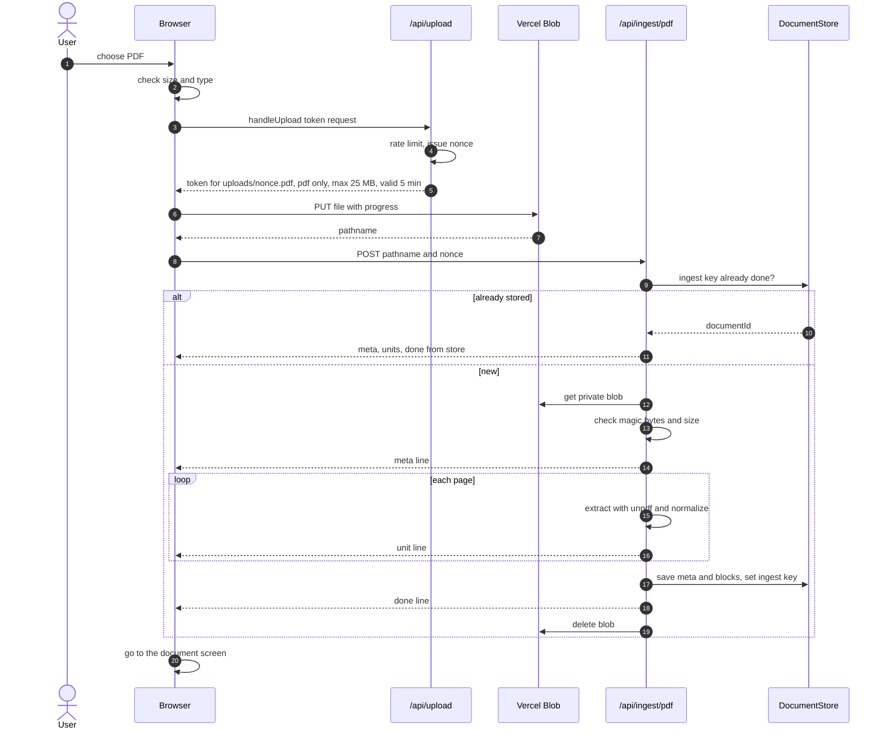
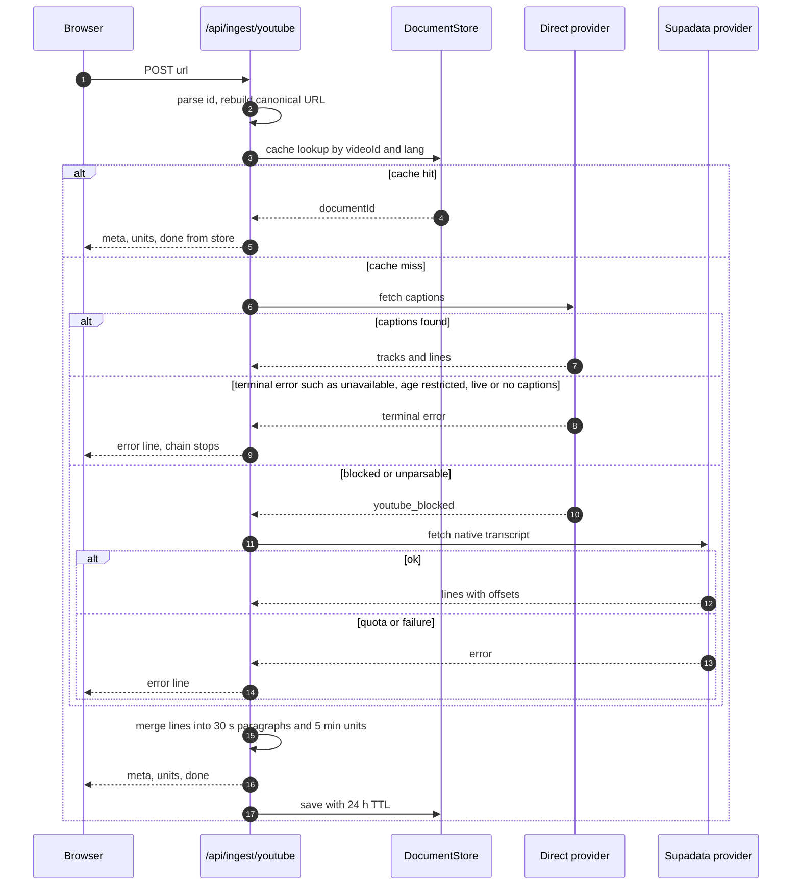
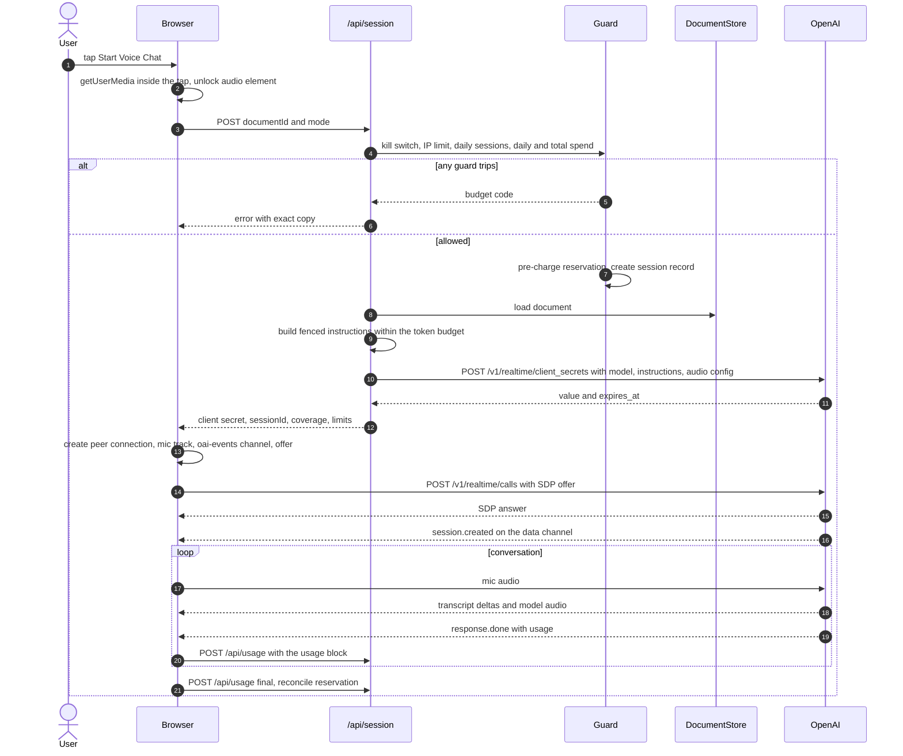
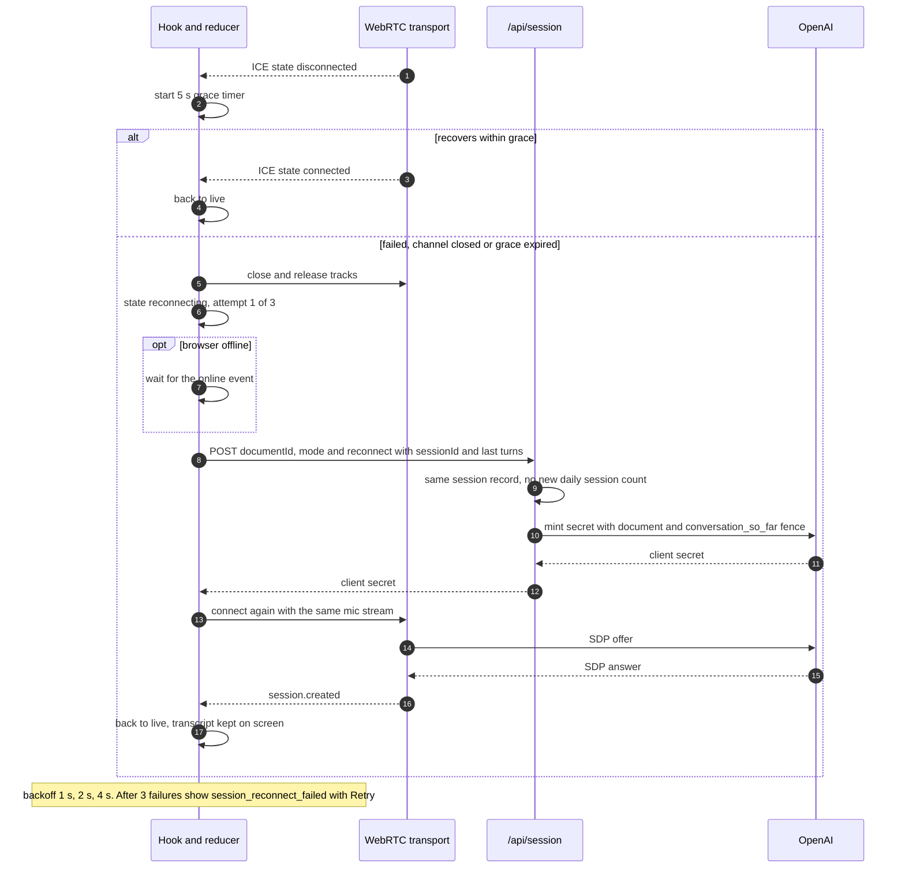
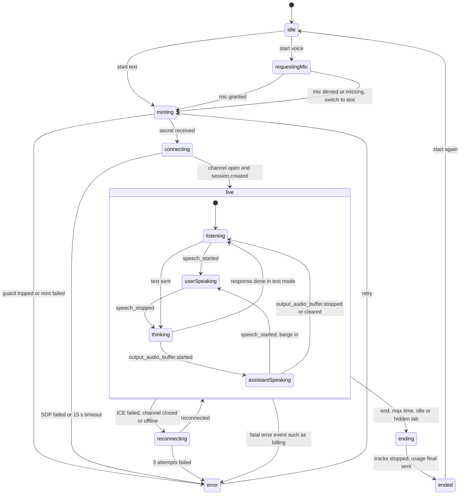

# ARCHITECTURE

Status: v1, 2026-11-09. Requirements live in [SPEC.md](SPEC.md), milestones in [PLAN.md](PLAN.md). External facts come from [reference/](reference/); when this file and a reference disagree, the reference wins for API shapes and this file wins for our design.

## 1. Shape of the system

```
Browser (Next.js client)                 Vercel Functions (Node, Fluid)             External
───────────────────────                  ───────────────────────────────            ────────
ingest UI ── PUT file ────────────────────────────────────────────────────────────► Vercel Blob (private)
          ── POST /api/upload (token) ─► upload service
          ── POST /api/ingest/pdf ─────► pdf service ── get / del ────────────────► Vercel Blob
                  ◄── NDJSON stream ──── └─► DocumentStore ──────────────────────► Upstash Redis
          ── POST /api/ingest/youtube ─► youtube service ── direct ──────────────► youtube.com
                  ◄── NDJSON stream ──── └─ fallback ────────────────────────────► Supadata
voice UI  ── POST /api/session ────────► session service ── client_secrets ──────► OpenAI
          ── SDP offer ─────────────────────────────────────────────────────────► OpenAI /v1/realtime/calls
          ◄═ WebRTC audio + "oai-events" data channel ══════════════════════════► OpenAI Realtime
          ── POST /api/usage ──────────► usage service ── UsageLedger ────────────► Upstash Redis
```

The browser talks to OpenAI directly for media, using a 60 s client secret minted by our server. The server never proxies audio and never sees the data channel. That is why usage is reported by the client and treated as advisory (SPEC §7.4).

## 2. Module map

```
src/
  app/                              Next routes. Pages render features; route handlers stay thin.
    page.tsx                        ingest screen
    d/[id]/page.tsx                 document + chat screen
    api/
      health/route.ts               GET  liveness, build sha, state driver (no secrets)
      limits/route.ts               GET  voice enabled? reason code if a guard is tripped
      upload/route.ts               POST Blob client-upload token (handleUpload)
      ingest/pdf/route.ts           POST {pathname, nonce} or multipart → NDJSON
      ingest/youtube/route.ts       POST {url, lang?} → NDJSON
      documents/[id]/route.ts       GET  stored document (meta + pages), for reload and retries
      session/route.ts              POST {documentId, mode, reconnect?} → client secret + coverage
      usage/route.ts                POST {sessionId, reports[], final?} → priced into the ledger
      cron/cleanup/route.ts         GET  daily: delete orphan blobs (CRON_SECRET)
  features/                         client code, grouped by feature
    ingest/                         source switch, file picker, URL field, upload client, NDJSON reader
    document/                       header, notices, collapsible text preview
    voice/
      realtime/                     protocol only, no React UI
        transport.ts                RealtimeTransport interface
        webrtc-transport.ts         RTCPeerConnection + data channel + mic/silent track
        mock-transport.ts           scriptable, replays recorded fixtures (tests, e2e)
        events.ts                   zod schemas for GA server events; unknown types → ignored
        reducer.ts                  pure state machine + transcript model
        use-realtime-session.ts     the one hook: mint, connect, events, usage, timers, cleanup
      ui/                           status pill, transcript, controls, composer, mic meter
  server/                           server-only (import "server-only"); never imported by client code
    env.ts                          the only reader of process.env; zod schema
    errors/                         AppError (code from the catalog, cause kept for logs)
    http/                           route helper: zod parse, AppError → { error }, request id, IP hash
    log.ts                          structured logger with redaction
    adapters/
      document-store/{types,memory,upstash}.ts
      rate-limiter/{types,memory,upstash}.ts
      usage-ledger/{types,memory,upstash}.ts
      index.ts                      picks memory or upstash from env.STATE_DRIVER
    upload/                         Blob token policy, nonce, direct multipart reader
    pdf/                            validate, extract (unpdf), normalize, ingest service
    youtube/
      parse-url.ts                  reference §4 parser
      provider.ts                   TranscriptProvider interface + typed results
      direct.ts                     InnerTube fetcher (consent, player, track pick, XML)
      supadata.ts                   Supadata adapter (M12)
      fixture.ts                    deterministic provider for e2e; refuses production
      chain.ts                      ordered fall-through on retryable failures only
      service.ts                    cache, sectioning into ~5 min units, NDJSON
    context/                        token count, budget, markers, fences, coverage
    realtime/                       client-secrets adapter, session config builder
    pricing/                        price table, cost(usage), reservation estimate
    guard/                          kill switch, IP limits, daily/total caps, reservation
    session/                        session service (guard → context → mint → record)
  lib/                              client-safe shared code
    errors/catalog.ts               code → status, copy, retry action
    wire/                           zod schemas for request/response bodies and NDJSON lines
    public-env.ts                   NEXT_PUBLIC_* non-secret config (upload mode, transport)
e2e/                                Playwright specs (390x844, Chromium + WebKit)
test/fixtures/                      PDFs, YouTube HTML/JSON/XML, Supadata JSON, realtime event logs
scripts/                            make-fixtures.ts, check-bundle-secrets.ts
```

Import rules, enforced with ESLint `no-restricted-imports`:
- `src/features/**` and `src/app/**/page.tsx` may not import `src/server/**`.
- `src/server/**` may import `src/lib/**`, never `src/features/**`.
- Only `src/server/env.ts` touches `process.env`, except `src/lib/public-env.ts`, which reads `NEXT_PUBLIC_*` only.

## 3. Route handlers

Every handler follows the same shape: `parse(zodSchema)`, then one service call, then a `Response`. AppError is mapped to `{ error: { code, message } }` with the catalog status. Exports are `runtime = "nodejs"` and, on ingest routes, `maxDuration = 300`.

**Next 16 note:** `next.config.ts` enables `cacheComponents`. Under Cache Components, `export const dynamic = "force-dynamic"` is removed, not migrated (`node_modules/next/dist/docs/01-app/02-guides/migrating-to-cache-components.md`). Route handlers that read the request already run at request time. We export only `runtime` and `maxDuration`.

| Route | Input (zod) | Output | Guards |
|---|---|---|---|
| `GET /api/health` | — | `{ ok, sha, driver }` | — |
| `GET /api/limits` | — | `{ voice: "ok" \| budget code }` | read-only |
| `POST /api/upload` | `HandleUploadBody` | Blob token JSON | upload limits (IP + global) |
| `POST /api/ingest/pdf` | `{ pathname, nonce }` (blob) or multipart `file` (direct) | NDJSON | ingest limit |
| `POST /api/ingest/youtube` | `{ url, lang? }` | NDJSON | ingest limit; Supadata guard |
| `GET /api/documents/[id]` | `id` (base64url, 22 chars) | `{ meta, pages[] }` (streamed when large) | read limit |
| `POST /api/session` | `{ documentId, mode: "voice" \| "text", reconnect?: { sessionId, transcript[] } }` | `{ clientSecret, expiresAt, sessionId, model, coverage, limits: { maxSeconds, idleSeconds } }` | all budget guards |
| `POST /api/usage` | `{ sessionId, reports: Usage[], final? }` | `{ ok }` | session must exist; caps on report size |
| `GET /api/cron/cleanup` | header `Authorization: Bearer CRON_SECRET` | `{ deleted }` | Vercel cron only |

### NDJSON ingest protocol

One JSON object per line, `Content-Type: application/x-ndjson`:

```
{"type":"meta","documentId":"…","source":"pdf","title":"…","unitCount":120,"unitKind":"page"}
{"type":"unit","index":1,"label":"[Page 1]","text":"…"}
…
{"type":"done","stats":{"chars":412345,"tokens":98765,"emptyUnits":3,"lang":null,"autoCaptions":false}}
```

On failure after the stream started: `{"type":"error","code":"pdf_timeout"}` and the stream closes. The client treats a stream that ends without `done` or `error` as a network break and retries with the same idempotency key (PDF: blob pathname; YouTube: `videoId+lang`). Streaming keeps big documents clear of the 4.5 MB response cap.

## 4. State and storage

| Adapter | Memory impl (local, tests) | Upstash impl (Vercel) |
|---|---|---|
| DocumentStore | `Map` with TTL | `ttd:doc:{id}:meta` (JSON) + `ttd:doc:{id}:b:{k}` blocks of ≤ 512 KB of units, TTL 2 h (YouTube 24 h); `ttd:ingest:{key}` → id; `ttd:yt:{videoId}:{lang}` → id |
| RateLimiter | sliding window over timestamps | `@upstash/ratelimit` sliding window, prefix `ttd:rl:{name}`, `analytics: false`, 2 s timeout, **fail closed** for mint and upload, fail open for reads |
| UsageLedger | counters | `INCRBYFLOAT ttd:usd:day:{date}` and `ttd:usd:total`; `INCR ttd:sessions:day:{date}`; `ttd:session:{id}` (JSON: ipHash, model, reserved, reported, docId) TTL 1 h; `ttd:latch:voice_off` TTL 1 h |

The reservation is pre-charged at mint time (`+reserved`) and reconciled on the final usage report (`+(reported − reserved)`). A session that never reports keeps its full reservation. Blocks rather than per-page keys keep a 2,000-page PDF to a handful of Redis commands, under the free plan's 500K/month and 10 MB per request.

## 5. Sequence diagrams

### 5.1 PDF ingest through Blob



Failures before `done` produce an `error` line; the blob is deleted in a `finally` either way. Locally and in CI, `UPLOAD_MODE=direct` replaces steps 3–7 with a multipart POST to `/api/ingest/pdf`.

### 5.2 YouTube ingest with provider fallback



The chain order comes from `YOUTUBE_PROVIDERS` (for example `direct,supadata` locally after M12, `supadata` on Vercel if the direct attempt only adds latency there; measured in M12).

### 5.3 Session start with the ephemeral token



### 5.4 Reconnect



## 6. Realtime client state machine

The reducer is pure: `(state, action) → state`. Actions come from transport events (validated with zod), user commands and timers. Mute is a flag on `live`, not a state. Exhaustive switches over the action union.



Transcript model: items keyed by `item_id`, placed by `previous_item_id` (input transcription can arrive late), text built from deltas and replaced by the `done` text. A response ending with `status: "cancelled"` and `reason: "turn_detected"` or `"client_cancelled"` marks its item interrupted. `error` events are recoverable unless their code is a billing code. Cleanup on every exit path: stop tracks, close the data channel and peer connection, clear timers, release the Wake Lock, detach the audio element.

## 7. Session configuration (server-built)

From reference §1, all GA names: `session.type: "realtime"`, `model: env.REALTIME_MODEL`, `instructions` (section 6 of SPEC), `output_modalities: ["audio"]` (text mode sets `["text"]` per `response.create`, field placement confirmed in the M6 live checkpoint), `reasoning.effort: "low"`, `max_output_tokens: 1024`, `audio.input.transcription.model: "gpt-4o-mini-transcribe"`, `audio.input.noise_reduction.type: "near_field"`, `audio.input.turn_detection: { type: "semantic_vad", eagerness: "auto", create_response: true, interrupt_response: true }`, `audio.output.voice: "marin"`, `expires_after: { anchor: "created_at", seconds: 60 }`.

## 8. Environment

Validated lazily in `src/server/env.ts` (first request, not build). Secrets are marked S; none has a `NEXT_PUBLIC_` prefix. This is the M1 list; later milestones add their own variables.

| Var | S | Default | Notes |
|---|---|---|---|
| `OPENAI_API_KEY` | S | none | needed only for live sessions (`requireOpenAIKey()`) |
| `SUPADATA_API_KEY` | S | none | optional |
| `REALTIME_MODEL` | | `gpt-realtime-2.1-mini` | mini or `gpt-realtime-2.1`; production switches at the end |
| `REALTIME_VOICE` | | `marin` | |
| `REALTIME_REASONING_EFFORT` | | `low` | minimal, low, medium, high |
| `CONTEXT_TOKEN_BUDGET` | | 8000 | 1000-60000 |
| `MAX_SESSION_MINUTES` | | 5 | |
| `DOC_TTL_MINUTES` | | 120 | |
| `UPLOAD_MODE` | | `direct` locally, `blob` on Vercel | `direct` refused on Vercel |
| `VOICE_ENABLED` | | true | kill switch |
| `DAILY_SESSION_CAP` | | 40 | |
| `DAILY_SPEND_LIMIT_USD` | | 3 | |
| `ADMIN_TOKEN` | S | none | optional |
| `BLOB_READ_WRITE_TOKEN` | S | none | set by the Blob integration |
| `UPSTASH_REDIS_REST_URL` / `KV_REST_API_URL` | S | none | both names accepted |
| `UPSTASH_REDIS_REST_TOKEN` / `KV_REST_API_TOKEN` | S | none | set together with the URL |
| `NEXT_PUBLIC_REALTIME_TRANSPORT` | | `webrtc` | `mock` in e2e |

The state driver is inferred: Upstash variables present means `upstash`, otherwise `memory`. On Vercel (`VERCEL` or `VERCEL_ENV` set) the Upstash variables are required and `UPLOAD_MODE=direct` is refused, so a misconfigured preview fails loudly. `SPEND_LIMIT_USD`, `IP_HASH_SALT`, `CRON_SECRET` and `YOUTUBE_PROVIDERS` from the earlier draft move to the milestones that use them.

Next 16 note: with `cacheComponents`, `export const runtime` is a build error. Route handlers run on Node by default, so they export nothing.

## 9. Decisions

| Decision | Alternatives | Why |
|---|---|---|
| **Host on Vercel Hobby** | Render free web service; Railway | The budget is $0 with no card. Render's free web services spin down after about 15 minutes idle, so a reviewer's first request waits on a cold start. Railway is usage-based after a trial credit, so a multi-week review would need a paid plan or a card. Vercel Hobby is free, needs no card, runs Next.js natively, gives free Git previews, and offers free Blob and Upstash through the Marketplace. We accept its limits by design: 4.5 MB bodies (Blob client upload), 300 s functions (streamed ingest with a 240 s budget), and no long-lived processes (no sideband) |
| Browser uploads straight to Vercel Blob | Multipart through the function; S3 presigned | Function bodies stop at 4.5 MB and our cap is 25 MB. Blob is free on Hobby and in-platform. `multipart: true` is skipped because it costs extra advanced ops and only helps above 100 MB |
| Private Blob store, delete after ingest | Public store; keep files | We never serve PDFs back. Private plus delete limits exposure and keeps us far from the 1 GB cap and the 30-day lock-out |
| Stream ingest as NDJSON | One JSON response; SSE | Streamed responses are exempt from the 4.5 MB cap; NDJSON is trivial to parse with `fetch` and a reader, works as a POST (SSE `EventSource` is GET-only), and lets the preview fill as pages arrive |
| unpdf for extraction | pdf-parse; pdfjs-dist directly | unpdf ships a serverless build of pdf.js with no worker or canvas setup, gives per-page text for `[Page n]` markers, and surfaces pdf.js exceptions (password, invalid) we map to codes. pdf-parse is unmaintained and merges pages |
| Ephemeral client secret, browser to OpenAI over WebRTC | Unified `/v1/realtime/calls` with our server in the SDP path; WebSocket relay | The brief's model: the key stays on the server, media goes peer-to-peer with low latency, and no function holds a connection open (Hobby has no long-lived processes) |
| No sideband WebSocket | Server attaches via `call_id` for authoritative usage | It would need a function alive for the whole chat; the 300 s limit is shorter than a 10-minute session. We use reservations and count caps instead (SPEC §7.4) |
| Instructions built on the server from DocumentStore | Client sends the text | The client cannot inject instructions or swap the document; one place does fencing and the budget |
| Server VAD (`semantic_vad`) with interrupt | Push-to-talk; `server_vad` | Natural barge-in for the interrupt step of the review; semantic VAD waits for a complete thought, so fewer accidental turns, which also saves money. Manual Stop covers noisy rooms |
| Voice `marin` | other voices | Recommended by OpenAI for quality; locked after the first audio |
| `gpt-4o-mini-transcribe` for user captions | `gpt-transcribe`; none | Cheapest model that works with VAD over WebRTC; `gpt-transcribe` is WebSocket-only for committed turns. Sunset 2027-02-26 is noted in the README |
| Three adapters, memory or Upstash by env | Module memory; SQLite; Postgres | Functions do not share memory across instances. Upstash's free plan needs no card and is HTTP-based (no connection pool). Memory keeps tests fast and offline |
| Pre-charged reservation plus client-reported usage | Trust reported usage; sideband | The server cannot see `response.done`. Reservations keep spend guards conservative whatever the client reports |
| YouTube provider chain: direct, then Supadata | Supadata only; a residential proxy; the YouTube Data API | Direct is free and works locally; YouTube blocks cloud IPs, so Supadata (free plan, no card) covers Vercel. Proxies cost money. The Data API only serves captions for videos you own |
| Hand-written caption XML parser | fast-xml-parser; xml2js | The format is flat `<text start dur>` elements. A small parser that rejects DTDs avoids XXE and entity-expansion risk without a dependency |
| No `middleware.ts` / `proxy.ts` | Middleware for headers and rate limits | Next buffers proxied request bodies at 10 MB, which would truncate local 25 MB direct uploads. Headers go in `next.config.ts`, limits in handlers |
| Cache Components on; route config limited to `runtime` and `maxDuration` | `dynamic = "force-dynamic"` | Next 16 removes `dynamic` under Cache Components; request-reading handlers are already dynamic |
| Mock transport for tests and e2e | Live API in CI | The $20 budget forbids live calls in tests; recorded fixtures from the M6 checkpoint keep the mock honest |
| Playwright on Chromium and WebKit at 390x844 | Chromium only | WebKit is the closest proxy for iOS Safari in CI; real devices are checked by hand (SPEC MC-3, MC-4) |
