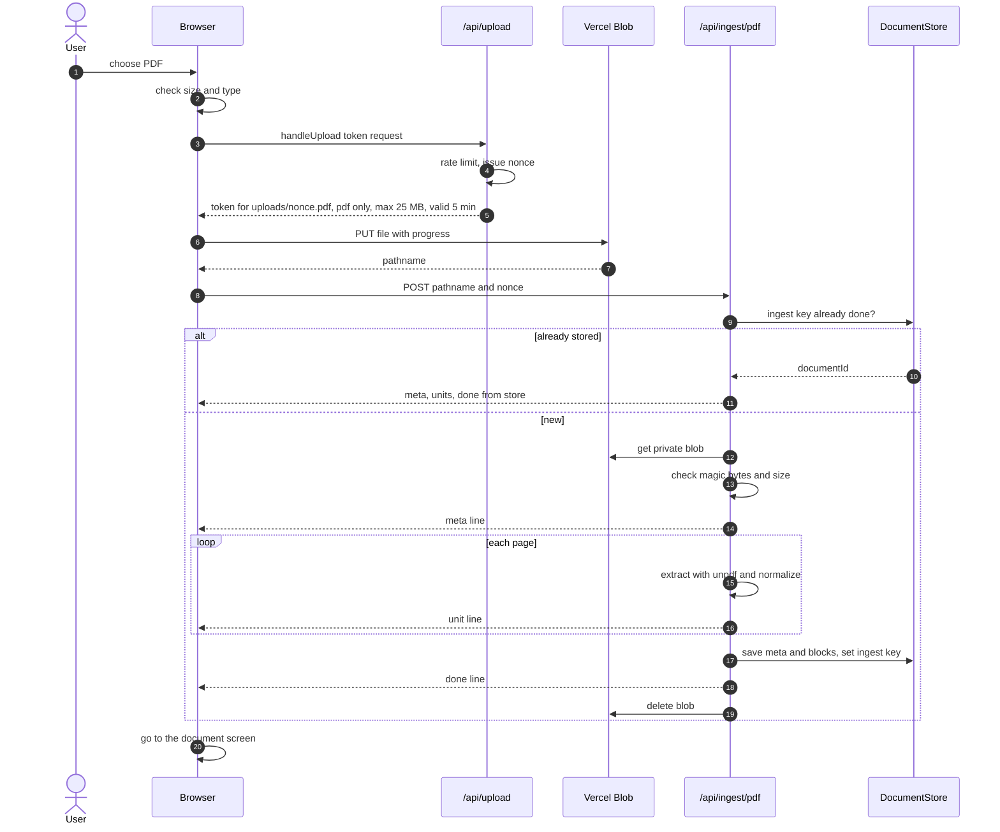
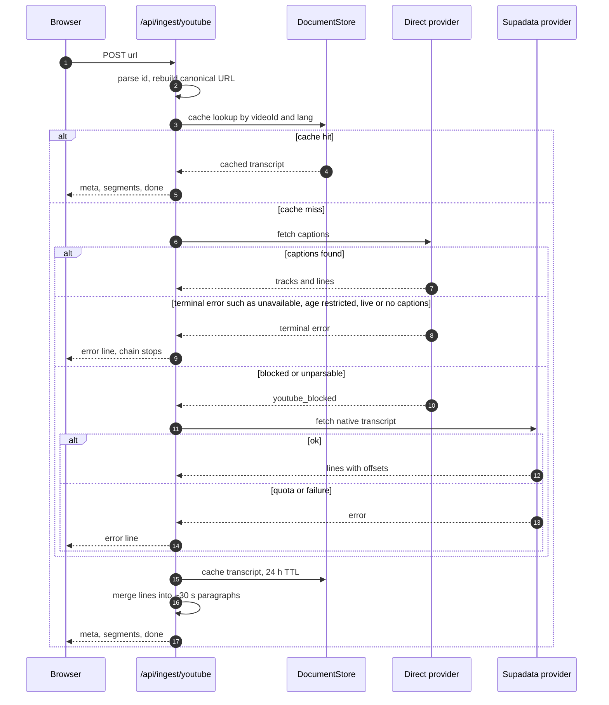
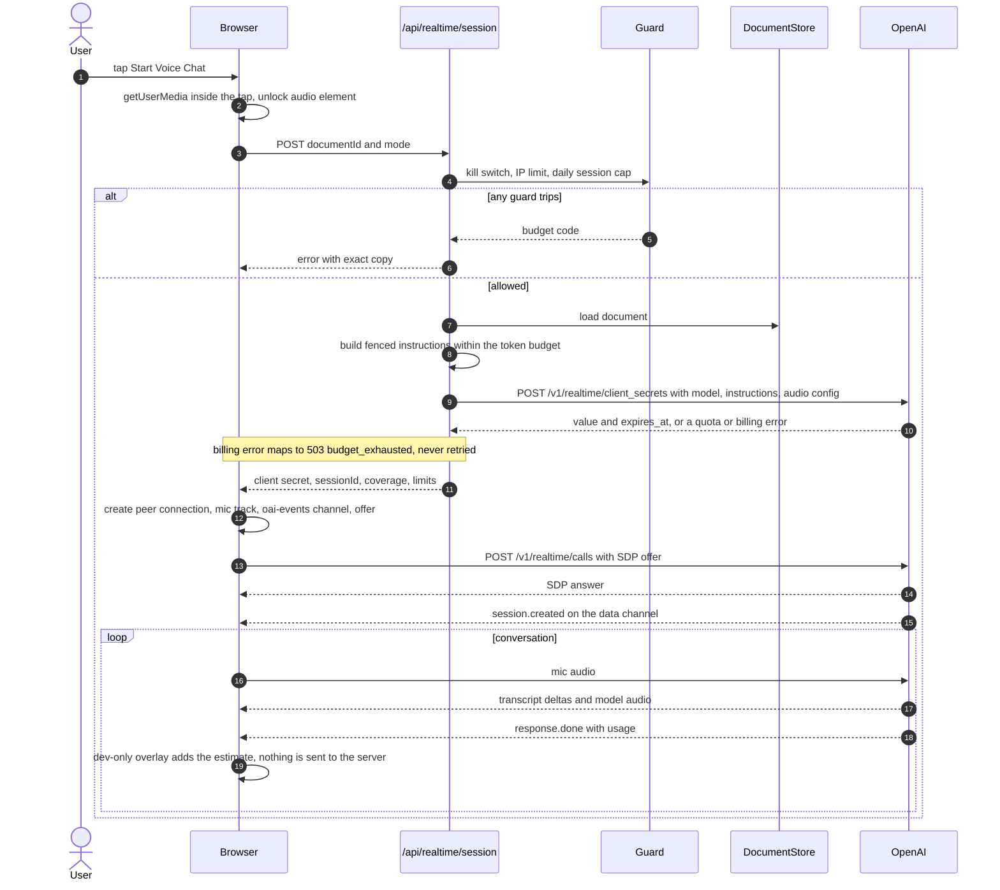
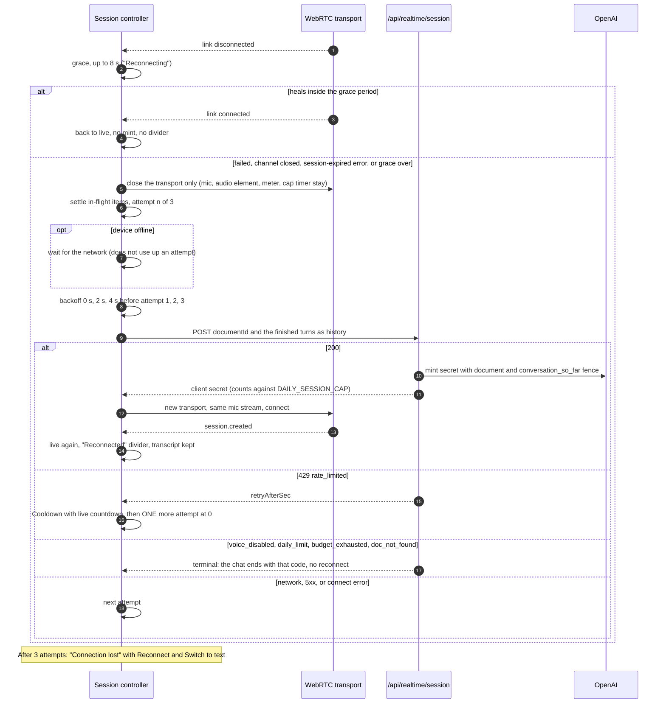
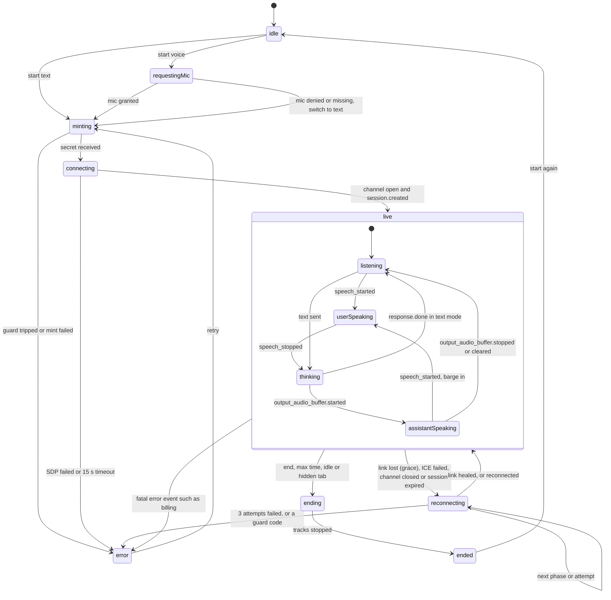

# ARCHITECTURE

Status: v1, 2026-11-09. Requirements live in [SPEC.md](SPEC.md), milestones in [PLAN.md](PLAN.md). External facts come from [reference/](reference/); when this file and a reference disagree, the reference wins for API shapes and this file wins for our design.

## 1. Shape of the system

```
Browser (Next.js client)                 Vercel Functions (Node, Fluid)             External
───────────────────────                  ───────────────────────────────            ────────
ingest UI ── PUT file ────────────────────────────────────────────────────────────► Vercel Blob (private)
          ── POST /api/upload (token) ─► upload service
          ── POST /api/ingest/pdf ─────► pdf service ── get / del ────────────────► Vercel Blob
                  ◄── NDJSON stream ──── └─► DocumentStore ──────────────────────► Upstash Redis
          ── POST /api/ingest/youtube ─► youtube service ── direct ──────────────► youtube.com
                  ◄── NDJSON stream ──── └─ fallback ────────────────────────────► Supadata
voice UI  ── POST /api/realtime/session ────────► session service ── client_secrets ──────► OpenAI
          ── SDP offer ─────────────────────────────────────────────────────────► OpenAI /v1/realtime/calls
          ◄═ WebRTC audio + "oai-events" data channel ══════════════════════════► OpenAI Realtime
```

The browser talks to OpenAI directly for media, using a 60 s client secret minted by our server. The server never proxies audio and never sees the data channel. That is why the server keeps no spend accounting: OpenAI's hard limit on the key is the backstop, and the client only shows a dev-only cost estimate from `response.done` events (SPEC §7).

## 2. Module map

Tests sit next to the code (`*.test.ts`), except what several suites share, which lives in `test/`. `scripts/spec-proofs.test.ts` keeps the paths in SPEC.md true; the lists below are checked by eye in review.

```
src/
  app/                              Next routes. Pages render features; route handlers stay thin.
    layout.tsx, page.tsx            root layout (AppShell, fonts, viewport) and the ingest screen
    not-found.tsx, error.tsx, global-error.tsx   "Page not found.", a crash below the layout, a crash of the layout itself
    manifest.ts, icon.svg, apple-icon.png, favicon.ico, globals.css
    api/
      health/route.ts               GET  { ok, version, uploadMode, state }: liveness, build, upload mode, state driver (no secrets)
      upload/token/route.ts         POST Blob client-upload token (handleUpload, token events only)
      ingest/pdf/route.ts           POST {blobUrl, fileName?} (blob) or multipart "file" (direct) → NDJSON
      ingest/youtube/route.ts       POST {url, lang?} → NDJSON
      realtime/session/route.ts     POST {documentId, history?} → client secret (history = the finished turns, on a reconnect)
      cron/cleanup/route.ts         GET  daily: delete orphan uploads (CRON_SECRET)
  components/                       app-wide UI
    app-shell.tsx                   header, offline banner, main; inert while a chat is open
    status-screen.tsx               the message screen behind not-found and the error pages
    offline-banner.tsx, retry-button.tsx, chat-open.ts   offline notice; a button that counts down a 429's wait; "is a chat open" store
    ui/                             shadcn primitives (button, popover, progress, sheet)
  features/                         client code, grouped by feature
    ingest/
      ingest-screen.tsx, use-ingest.ts, ingest-state.ts   the screen, the one hook that runs a load (retries, stall detector), its reducer
      upload-client.ts, ndjson-reader.ts, ingest-error.ts  fetch/XHR with deadlines and the one retry, NDJSON with an idle timeout, typed failures
      validate-pdf.ts, validate-youtube.ts   the client's checks first: size, type, the %PDF- header; the link
      source-switch.tsx, pdf-picker.tsx, youtube-field.tsx, sample-chips.tsx, upload-status.tsx, error-card.tsx, error-copy.ts, partial-notice.tsx
    document/
      document-card.tsx, ready-bar.tsx   the ready document and its bottom bar
      text-preview.tsx, full-text-sheet.tsx, text-groups.ts   excerpt, the full-screen text sheet, grouping/search/reflow
      references.ts                 "page 12" and "[04:05]" in an answer → chips that open the text there
      format.ts
    voice/
      realtime/                     the engine: protocol only, no UI. Framework-agnostic core + one hook
        transport.ts                RealtimeTransport interface, TransportError kinds
        webrtc-transport.ts         RTCPeerConnection + "oai-events" channel; connected only after open + session.created; 15 s deadline
        mock-transport.ts           scripted server (timed steps + replies to client events); scriptFromRecording() replays a recorded session
        mock-scenarios.ts, mock-names.ts   named scripts for tests and e2e (?mockRealtime=<name>); names kept apart so the mock stays a lazy chunk
        transport-factory.ts        mock (dev or mock build, ?mockRealtime=) or WebRTC
        events.ts, wire-events.ts   zod union for handled GA server events (unknown ones counted, never thrown); builders for the same events in tests
        state.ts, transcript.ts     state shape; previous_item_id ordering (epoch, then chains, arrival only as tie-break)
        reducer.ts                  pure (state, action) => state: transcript, interruption, activity, connection
        session.ts                  VoiceSession controller: mic, mint, transport, timers, cleanup; carries out the reconnect machine's effects; deps injected
        reconnect.ts                pure reconnect state machine (grace, attempts, backoff, offline wait, 429 cooldown); see 5.4
        session-deps.ts, mint.ts, mic.ts, audio.ts, levels.ts   browser wiring, mint client, getUserMedia, tap-time audio objects, AnalyserNode meters
        client-events.ts, failure.ts, usage.ts   events we send, client-side codes and copy, token totals
        prices.ts, cost.ts          per-model rates (with fetch date) and the session cost estimate
        recorder.ts, debug.ts       dev-only JSONL event log (redacts instructions and secrets), the ?debug=1 switch
        use-voice-session.ts        the one hook: state, actions, level feed, estimated cost
      ui/                           renders state, holds no protocol logic
        voice-chat.tsx              wraps the ready document; opens the chat in <body> (portal) so the page can be inert
        conversation-screen.tsx     the full-screen chat: header, orb, transcript, composer or control bar, sheets
        transcript.tsx, bubble.tsx, use-stick-to-bottom.ts   conversation list, one bubble, scroll-pinning (re-pins when the keyboard resizes it)
        composer.tsx, control-bar.tsx, end-confirm.tsx, session-menu.tsx, export-buttons.tsx
        status-pill.tsx, status-map.ts, orb.tsx, level-dot.tsx, session-timer.tsx, reconnect-notice.tsx, failure-card.tsx
        mic-banner.tsx, mic-coach.ts   why the mic is off, and the exact taps to turn it on
        use-compact-layout.ts, use-visual-viewport.ts, use-wake-lock.ts
      export/                       transcript as Markdown: build, copy, download
      dev-cost/                     dev-only overlay (cost-overlay.tsx), shown in development or with ?debug=1; never reported
  server/                           server-only (import "server-only"); never imported by client code
    env.ts                          the only reader of process.env; zod schema; EnvError
    errors.ts, http.ts, body.ts, read-capped.ts, log.ts   AppError and its client-safe mapping; the route wrapper (request id, rate-limit helpers); JSON bodies with byte caps; capped stream reads; the one request log line
    state/                          the two adapters: types.ts, memory.ts, upstash.ts, index.ts (picks one from env); contract suite in test/state-contract.ts
    security/                       client-ip.ts (/64 for IPv6), rate-limit.ts (HMAC-keyed limiter calls, fail closed), limits.ts
    ingest/
      record.ts                     what DocumentStore keeps: the context cut to the token budget, never the full text
      pdf/                          request.ts (route logic), validate, extract (unpdf), normalize, stream, title, concurrency; blob.ts, upload-token.ts, cleanup.ts; multipart.ts; limits.ts
      youtube/                      request.ts (route logic), index.ts (the chain), provider.ts, direct.ts (InnerTube), supadata.ts, oembed.ts, captionsXml.ts, pickTrack.ts, format.ts (~30 s paragraphs), cache.ts, guard.ts (daily Supadata cap), deadline.ts, limits.ts
    context/                        budget.ts (token count and the CONTEXT_TOKEN_BUDGET cut), buildInstructions.ts (rules, fences, coverage, history)
    realtime/createClientSecret.ts  the one call to OpenAI's client_secrets, with its timeout and typed errors
    session/                        service.ts (guards → document → instructions → mint), document.ts, identity.ts (anonymous safety id), limits.ts
  lib/                              client-safe shared code
    errors/catalog.ts               code → status, copy, retry action
    wire/                           zod schemas for request/response bodies and NDJSON lines (ingest.ts, session.ts, ndjson.ts)
    youtube/                        parseUrl.ts (strict URL parser), timestamp.ts
    net/                            timeout.ts (deadline + abort), retry.ts (one retry with jitter), connectivity.ts (offline store, waitForConnection), use-online.ts
    nav/                            history-layers.ts, use-history-layer.ts: Back closes a sheet, then the chat, then the ready document (section 3.5 of the SPEC)
    public-env.ts, limits.ts, security-headers.ts, download.ts, use-countdown.ts, zod-jitless.ts, utils.ts
e2e/                                Playwright specs (390x844, Chromium + WebKit); support.ts holds the shared helpers
test/                               setup.ts, fixtures.ts, state-contract.ts, realtime/ (harness, fakes, script), youtubeFetch.ts, fixtures/ (pdf, youtube, realtime, audio)
scripts/                            smoke.ts, make-fixtures.ts, check-bundle-secrets.ts, coverage-summary.ts, record-youtube-fixtures.ts, make-icons.ts, spec-proofs.test.ts
```

Import rules, enforced with ESLint `no-restricted-imports`:
- `src/features/**` and `src/app/**/page.tsx` may not import `src/server/**`.
- `src/server/**` may import `src/lib/**`, never `src/features/**`.
- Only `src/server/env.ts` touches `process.env`, except `src/lib/public-env.ts`, which reads `NEXT_PUBLIC_*` only.

## 3. Route handlers

Every handler is `handle("<name>", fn)` from `src/server/http.ts`, which adds the request id, the one log line and the error mapping, around one service call. The service rate-limits first (fail closed), then validates with zod, then does its work and returns a `Response`. An AppError is mapped to `{ error: { code, message }, requestId }` with the catalog status; anything else is `internal`. Each route exports `maxDuration` and nothing else: no `runtime` and no `dynamic`.

**Next 16 note:** `next.config.ts` enables `cacheComponents`. Under Cache Components, `export const runtime` and `export const dynamic = "force-dynamic"` are errors (`node_modules/next/dist/docs/01-app/02-guides/migrating-to-cache-components.md`). Route handlers run on Node by default and, if they read the request, at request time.

| Route | `maxDuration` | Input (zod) | Output | Guards |
|---|---|---|---|---|
| `GET /api/health` | 10 s | none | `{ ok, version, uploadMode, state }` (`state` is `memory` or `upstash`; nothing else about the setup) | health limit per IP (120/min) |
| `POST /api/upload/token` | 15 s | `generate-client-token` event only | Blob token JSON | token limit per IP (20/hour) and a global 150 a day (`rate_limited` until UTC midnight) |
| `POST /api/ingest/pdf` | 60 s (stops itself at 55 s) | `{ blobUrl, fileName? }` (blob) or multipart `file` (direct) | NDJSON | ingest limit per IP (10/min), 2 extractions at once per instance |
| `POST /api/ingest/youtube` | 60 s | `{ url, lang? }` | NDJSON | ingest limit (10/min); Supadata guard (15 lookups per UTC day, `youtube_quota`) |
| `POST /api/realtime/session` | 20 s | `{ documentId, history?: [{ role: "user" \| "assistant", text }] }`, body capped at 512 KB | `{ clientSecret, expiresAt, model, maxSessionSeconds }` (`expiresAt` is unix seconds, as OpenAI sends it) | `VOICE_ENABLED`, per-IP limit (15 per 10 min; a 429 carries `Retry-After` and `error.retryAfterSec`), `DAILY_SESSION_CAP` (counted only after a successful mint); OpenAI quota or billing error → 503 `budget_exhausted` |
| `GET /api/cron/cleanup` | 30 s | header `Authorization: Bearer CRON_SECRET` | `{ deleted }` | Vercel cron only (daily, `vercel.json`); cron limit per IP (5/min) before the secret is checked; deletes `uploads/*.pdf` older than 1 h |

### NDJSON ingest protocol

One JSON object per line, `Content-Type: application/x-ndjson`:

PDF (M2). Lines are told apart by their keys; schemas are in `src/lib/wire/ingest.ts`:

```
{"documentId":"…","title":"…","sourceType":"pdf","pages":120}
{"page":1,"text":"…"}
…
{"done":true,"stats":{"pages":120,"words":2400,"tokens":3830},"coverage":1}
```

YouTube (M3). Same framing, and the same `done` line shape with `segments` in place of `pages`:

```
{"documentId":"…","title":"…","sourceType":"youtube","videoId":"…","thumbnailUrl":"https://i.ytimg.com/vi/…/hqdefault.jpg","channel":"…","durationSec":1203,"language":"en","isAutoGenerated":false,"provider":"direct","cached":false}
{"segment":{"startSec":0,"text":"…"}}
…
{"done":true,"stats":{"segments":36,"words":3170,"tokens":4165},"coverage":1}
```

A segment is one ~30 second paragraph. `isAutoGenerated` is `null` when the provider cannot tell (Supadata). `provider` is the one that served the transcript; with `cached: true` it is the one that served it originally. Everything that can refuse (rate limit, bad link, no captions, quota) happens before the first byte, so those are JSON errors with an HTTP status.

Pages go out as each one is read. Stats and coverage need every page, so they are on the `done` line, not the first one; that is what puts the first page on the wire in about 0.3 s on the 120-page sample instead of after the whole file. Anything the server can refuse before reading a page (size, type, rate limit, password, damaged file, page count) is a normal JSON error with its HTTP status, before the stream starts.

On failure after the stream started: `{"error":{"code":"pdf_timeout","message":"…"}}` and the stream closes (a scan with no text layer is found at the end and ends this way; nothing is stored). A stream that ends without `done` or `error` is a network break. The M3 YouTube lines will follow the same framing. Idempotent retry (SPEC §5.1) is not built yet: in blob mode the blob is deleted as soon as it is read, so a retry means uploading again. Streaming keeps big documents clear of the 4.5 MB response cap. On the client, a stream that ends without `done`, goes quiet for 30 s, or breaks in transit throws `StreamBrokenError`; the pages already received stay on screen (`partial` state) with Try again. A YouTube stream that breaks is asked for again once, silently (the transcript is cached server-side).

## 4. State and storage

Two adapters in `src/server/state`, chosen by env (Upstash variables present means `upstash`, otherwise `memory`). Nothing relies on module-level memory in production.

| Adapter | Memory impl (local, tests) | Upstash impl (Vercel) |
|---|---|---|
| DocumentStore (`put`, `get`, `delete`, with a TTL) | `Map` with expiry | `{ns}:doc:{id}` → one JSON string, `PX` TTL. The record is the extracted context cut to the token budget plus stats and coverage, never the full text (the browser has it already). Cached YouTube transcripts live in the same store under the id `yt:{videoId}:{lang}`, TTL 24 h, and are skipped when over 500 KB (Upstash's request cap is 1 MB). Documents: `DOC_TTL_MINUTES` (2 h) |
| RateLimiter (`limit` sliding window, `countDaily`, `peekDaily`) | timestamps in a `Map`; daily counter keyed by UTC date | `@upstash/ratelimit` sliding window under `{ns}:rl:{name}`, 2 s timeout, **fail closed** everywhere (a limiter that cannot answer refuses the request: `service_busy`); daily counters are `{ns}:daily:{key}:{date}` with a 48 h TTL |

`{ns}` is the state namespace from `env.ts`: `ttd` in Production, `ttd-preview` in Preview, `ttd-local` otherwise. The free Upstash plan has one database shared by every environment, so a preview cannot spend Production's daily caps. The live contract suite (`src/server/state/state.test.ts`) writes only under `ttd-test:<timestamp>` and deletes it afterwards, and runs only with `RUN_LIVE_UPSTASH_TESTS=1`.

Each document is one Redis command and well under the free plan's 10 MB per request.

## 5. Sequence diagrams

### 5.1 PDF ingest through Blob



Failures before `done` produce an `error` line; the blob is deleted in a `finally` either way. Locally and in CI, `UPLOAD_MODE=direct` replaces steps 3–7 with a multipart POST to `/api/ingest/pdf`.

### 5.2 YouTube ingest with provider fallback



The chain is Direct, then Supadata when `SUPADATA_API_KEY` is set. On Vercel with a fallback, Direct gets a 3 s fast-fail (15 s otherwise); it falls through on `BLOCKED`, `UPSTREAM_TIMEOUT` and `UPSTREAM_FAILED` only. There is no `YOUTUBE_PROVIDERS` switch: the key is the switch.

### 5.3 Session start with the ephemeral token



### 5.4 Reconnect

The rules live in one pure module, `src/features/voice/realtime/reconnect.ts`: `reconnectStep(state, input, ctx) → { state, effects }`. The session controller feeds it what happened (link events, timers, mint and connect results) and carries out the effects, so every rule below is tested with plain values and fake timers.



What counts as what:

| Rule | Behavior |
|---|---|
| Grace | 8 s on `disconnected` (`RECONNECT_GRACE_MS`). Recovery inside it costs nothing. |
| Triggers for a new session | `failed` (ICE or peer connection), the data channel closing under us, an `error` event with a session-expired code, or the end of grace. |
| Attempts | At most 3 per outage, backoff 0 / 2 / 4 s. **A link that comes back and drops again within 30 s (`STABILITY_WINDOW_MS`) is the same outage**: the attempt count carries on from where the rebuild left it, so a flapping link spends attempts 1, 2, 3 and then stops. After 30 s of staying up the next drop starts again at 1. On top of that, **one chat gets at most 6 reconnect mints** (`MAX_RECONNECT_MINTS_PER_CHAT`), however stable the link was in between. The machine keeps this in a per-chat ledger (`mints`, when and at which attempt the last rebuild came up), and every road into "minting" goes through one function, so the budget cannot be bypassed. **Every attempt is one mint and counts against `DAILY_SESSION_CAP`**, as any mint does. (An earlier draft said reconnects do not count. The server cannot tell a reconnect from a new chat without a token a client could replay, so it counts every mint and the doc follows the code.) A manual Reconnect or Switch to text is a new chat with a new budget. |
| Offline | Nothing is minted while `navigator.onLine` is false or the last request got no answer. The wait ends on the `online` event or a successful `/api/health` probe (2 s, then 4, 8 … 30 s). It does not use up an attempt, and the three-attempt cap still bounds the whole outage. |
| 429 | M8's rule holds: the pill says Cooldown, not Offline, and the notice counts down from a deadline. The 429 uses up its attempt, waits exactly `retryAfterSec`, then makes one more attempt with no backoff on top. Three 429s in a row end in the ordinary Cooldown failure card, whose button counts down and then reconnects with the transcript (it does not resume by itself: the three-attempt bound holds). It can never become a loop. |
| Never reconnect | `voice_disabled`, `daily_limit`, `budget_exhausted` (and `doc_not_found`, `invalid_request`) end the chat with their own code. |
| What survives | The mic stream, audio element, AudioContext, level meter, wake lock and the cap deadline. A reconnect does not stretch the chat's length, and the idle timer does not run while reconnecting. Only the transport is replaced. |
| What is sent | The finished turns on screen (`visibleTurns()`, clamped by `clampHistory`) in the `conversation_so_far` fence, as for the M8 mic restart. In-flight items are settled first (a half-spoken answer becomes "(interrupted)"). |
| After the last attempt | `session_reconnect_failed`, shown as "Connection lost" with **Reconnect** (a fresh session with the transcript carried over) and **Switch to text** (the same, without a mic). |

**Mic track ended** (Bluetooth switch, an OS interruption, a call): `getUserMedia` once, then `sender.replaceTrack` on the connection that already exists. No renegotiation and no new client secret, the muted flag is kept, and a mid-reconnect swap simply becomes the stream the next connect uses. If the mic ends during the 8 s grace, or while the new connection is being made, the new track is held and swapped in with `replaceTrack` as soon as the link is up (a healed link keeps its old sender, and a connect that was already under way was started with the dead track). Turning the mic on while the link is being rebuilt takes the same road instead of restarting the chat. If the swap fails, or the mic ends again within 3 s, the chat carries on in text. This is the same road as "Try microphone again" (SPEC §4.2).

**First start while offline.** A mint whose `fetch` threw before any response created nothing, so the tap's mic and audio unlock are kept, the pill says Offline, and the mint is tried once more when the connection is back (at most 60 s). One chat still means one secret.

**Expired document.** `doc_not_found` from a mint (the 2 h TTL passed) shows **Load it again**. The ingest screen still holds the file, sample or link in memory (`lastRequestRef`), so one tap re-runs the same ingest. The chat itself is gone; the new document is a new chat.

## 6. Realtime client state machine

The reducer is pure: `(state, action) → state`. Actions come from transport events (validated with zod), user commands and timers. Mute is a flag on `live`, not a state. Exhaustive switches over the action union.



Transcript model: items keyed by `item_id`, placed by `previous_item_id` (input transcription can arrive late), text built from deltas and replaced by the `done` text. A response ending with `status: "cancelled"` and `reason: "turn_detected"` or `"client_cancelled"` marks its item interrupted. `error` events are recoverable unless their code is a billing code. Cleanup on every exit path: stop tracks, close the data channel and peer connection, clear timers, release the Wake Lock, detach the audio element.

As built in M6 (the diagram's `minting` and `error` are `connecting{phase}` and `failed{code}`; `ending` is not a state because cleanup is synchronous):
- Only the *current* response, or the one whose audio is playing, may move `activity`. A barge-in (`speech_started` during a response) marks the answer interrupted, keeps the words generated so far, freezes it (later deltas and `.done` text are dropped) and forgets that response, so its late `response.done` and `output_audio_buffer.cleared` never flip the UI back to "listening". An interrupted answer with no words is hidden but stays in the chain.
- Stop sends `response.cancel`, then `output_audio_buffer.clear` (voice only), and records both event ids as benign so a "nothing to cancel" error is swallowed.
- A typed message is a local `sending` bubble with a client item id, reconciled by the server's `conversation.item.added` for the same id. Asking while an answer is in progress cancels it first.
- Idle (120 s with no speech and no response; speaking is never idle), hidden tab (60 s) and the session cap (warning at 60 s left) are timers in the controller. An ICE `disconnected` shows `reconnecting` for an 8 s grace; since M9 the end of grace, a failed link or a closed channel re-mints (section 5.4). `reconnecting` carries `phase` (grace, waitingNetwork, backoff, minting, connecting, cooldown), `attempt`, `maxAttempts` and, in cooldown, `retryAt`. `epoch` counts sessions and `chatSeq` counts chats, so the chat timer survives a reconnect; `reconnectMarks` lists the epochs that began with a reconnect, where the transcript draws its "Reconnected" divider.
- Terminal states are sticky: a late failure cannot overwrite `ended`. Every exit path runs one idempotent cleanup.

## 7. Session configuration (server-built)

From reference §1, all GA names: `session.type: "realtime"`, `model: env.REALTIME_MODEL`, `instructions` (section 6 of SPEC), `output_modalities: ["audio"]` (text mode sets `["text"]` per `response.create`; the field placement is confirmed in the docs (2026-11-14), and text mode offers a sendrecv audio line with an empty sender, so `RealtimeTransport.upgradeMic()` can attach a mic later with `sender.replaceTrack` on the same connection; if that is refused, the session controller reconnects once with a fresh secret and the stream it already holds. The Realtime API accepting audio from a track attached this way was confirmed live on 2026-11-15, see reference §2), `reasoning.effort: "low"`, `max_output_tokens: 800` (audio tokens count toward it, at about 20 per second, so this bounds one answer to roughly 35 s of speech; a live session without it generated 33 s for one answer), `audio.input.transcription.model: "gpt-4o-mini-transcribe"`, `audio.input.noise_reduction.type: "near_field"`, `audio.input.turn_detection: { type: "semantic_vad", eagerness: "auto", create_response: true, interrupt_response: true }`, `audio.output.voice: "marin"`, `expires_after: { anchor: "created_at", seconds: 60 }`.

## 8. Environment

Validated lazily in `src/server/env.ts` (first request, not build). Secrets are marked S; none has a `NEXT_PUBLIC_` prefix. Every variable the app reads is here.

| Var | S | Default | Notes |
|---|---|---|---|
| `OPENAI_API_KEY` | S | none | needed only for live sessions (`requireOpenAIKey()`) |
| `SUPADATA_API_KEY` | S | none | optional |
| `REALTIME_MODEL` | | `gpt-realtime-2.1-mini` | mini or `gpt-realtime-2.1`; production switches to `gpt-realtime-2.1` at the end |
| `REALTIME_VOICE` | | `marin` | |
| `REALTIME_REASONING_EFFORT` | | `low` | minimal, low, medium, high |
| `CONTEXT_TOKEN_BUDGET` | | 8000 | 1000-60000; production uses 20000 at the end |
| `MAX_SESSION_MINUTES` | | 5 | |
| `DOC_TTL_MINUTES` | | 120 | |
| `UPLOAD_MODE` | | `direct` locally, `blob` on Vercel | `direct` refused on Vercel |
| `VOICE_ENABLED` | | true | kill switch |
| `DAILY_SESSION_CAP` | | 40 | session starts per UTC day, counted in RateLimiter. 40 in dev and preview; production sets 15 (DEPLOY.md) |
| `BLOB_READ_WRITE_TOKEN` | S | none | set by the Blob integration |
| `IP_HASH_SALT` | S | random per run locally | at least 16 characters; required on Vercel; keys the client-address hash for limits |
| `CRON_SECRET` | S | none | bearer token for the cleanup cron; unset means it refuses everyone |
| `UPSTASH_REDIS_REST_URL` / `KV_REST_API_URL` | S | none | both names accepted |
| `UPSTASH_REDIS_REST_TOKEN` / `KV_REST_API_TOKEN` | S | none | set together with the URL |
| `NEXT_PUBLIC_REALTIME_TRANSPORT` | | `webrtc` | `mock` in e2e |

The state driver is inferred: Upstash variables present means `upstash`, otherwise `memory`. On Vercel (`VERCEL` or `VERCEL_ENV` set) the Upstash variables and `IP_HASH_SALT` are required and `UPLOAD_MODE=direct` is refused, so a misconfigured preview fails loudly. There is no `YOUTUBE_PROVIDERS` switch: `SUPADATA_API_KEY` being set is the switch.

Next 16 note: with `cacheComponents`, `export const runtime` is a build error. Route handlers run on Node by default, so they export nothing.

## 9. Decisions

| Decision | Alternatives | Why |
|---|---|---|
| **Host on Vercel Hobby** | Render free web service; Railway | The budget is $0 with no card. Render's free web services spin down after about 15 minutes idle, so a reviewer's first request waits on a cold start. Railway is usage-based after a trial credit, so a multi-week review would need a paid plan or a card. Vercel Hobby is free, needs no card, runs Next.js natively, gives free Git previews, and offers free Blob and Upstash through the Marketplace. We accept its limits by design: 4.5 MB bodies (Blob client upload), a 60 s function budget on the ingest routes (the PDF pipeline stops itself at 55 s), and no long-lived processes (no sideband) |
| Browser uploads straight to Vercel Blob | Multipart through the function; S3 presigned | Function bodies stop at 4.5 MB and our cap is 25 MB. Blob is free on Hobby and in-platform. `multipart: true` is skipped because it costs extra advanced ops and only helps above 100 MB |
| Private Blob store, delete after ingest | Public store; keep files | We never serve PDFs back. Private plus delete limits exposure and keeps us far from the 1 GB cap and the 30-day lock-out |
| Stream ingest as NDJSON | One JSON response; SSE | Streamed responses are exempt from the 4.5 MB cap; NDJSON is trivial to parse with `fetch` and a reader, works as a POST (SSE `EventSource` is GET-only), and lets the preview fill as pages arrive |
| unpdf for extraction | pdf-parse; pdfjs-dist directly | unpdf ships a serverless build of pdf.js with no worker or canvas setup, gives per-page text for `[Page n]` markers, and surfaces pdf.js exceptions (password, invalid) we map to codes. pdf-parse is unmaintained and merges pages |
| Ephemeral client secret, browser to OpenAI over WebRTC | Unified `/v1/realtime/calls` with our server in the SDP path; WebSocket relay | The brief's model: the key stays on the server, media goes peer-to-peer with low latency, and no function holds a connection open (Hobby has no long-lived processes) |
| No sideband WebSocket | Server attaches via `call_id` for authoritative usage | It would need a function alive for the whole chat; the 300 s limit is shorter than a 10-minute session. We use count caps, per-IP limits and OpenAI's hard limit instead (SPEC §7.4) |
| Instructions built on the server from DocumentStore | Client sends the text | The client cannot inject instructions or swap the document; one place does fencing and the budget |
| Server VAD (`semantic_vad`) with interrupt | Push-to-talk; `server_vad` | Natural barge-in for the interrupt step of the review; semantic VAD waits for a complete thought, so fewer accidental turns, which also saves money. Manual Stop covers noisy rooms |
| Voice `marin` | other voices | Recommended by OpenAI for quality; locked after the first audio |
| `gpt-4o-mini-transcribe` for user captions | `gpt-transcribe`; none | Cheapest model that works with VAD over WebRTC; `gpt-transcribe` is WebSocket-only for committed turns. Sunset 2027-02-26 is noted in the README |
| Two adapters (DocumentStore, RateLimiter), memory or Upstash by env | Module memory; SQLite; Postgres | Functions do not share memory across instances. Upstash's free plan needs no card and is HTTP-based (no connection pool). Memory keeps tests fast and offline |
| OpenAI's hard limit on the key replaces a dollar ledger | A server-side dollar ledger with pre-charged reservations and client-reported usage; a sideband socket | OpenAI billing already enforces the $20 cap, so a second ledger can only drift from it, costs Redis commands, and depends on usage the server cannot see (`response.done` stays in the browser). Cheap guards stay (model, context budget, kill switch, session length, per-IP limit, daily session cap). A billing error maps to 503 `budget_exhausted`. The dev-only client overlay is advisory and reports nothing. We accept having no server-side spend view |
| YouTube provider chain: direct, then Supadata | Supadata only; a residential proxy; the YouTube Data API | Direct is free and works locally; YouTube blocks cloud IPs, so Supadata (free plan, no card) covers Vercel. Proxies cost money. The Data API only serves captions for videos you own |
| Hand-written caption XML parser | fast-xml-parser; xml2js | The format is flat `<text start dur>` elements. A small parser that rejects DTDs avoids XXE and entity-expansion risk without a dependency |
| No `middleware.ts` / `proxy.ts` | Middleware for headers and rate limits | Next buffers proxied request bodies at 10 MB, which would truncate local 25 MB direct uploads. Headers go in `next.config.ts`, limits in handlers |
| Cache Components on; route config limited to `maxDuration` | `dynamic = "force-dynamic"` | Next 16 removes `dynamic` under Cache Components; request-reading handlers are already dynamic |
| Mock transport for tests and e2e | Live API in CI | The $20 budget forbids live calls in tests; recorded fixtures from the M6 checkpoint keep the mock honest |
| Playwright on Chromium and WebKit at 390x844 | Chromium only | WebKit is the closest proxy for iOS Safari in CI; real devices are checked by hand (SPEC MC-3, MC-4) |

## 10. Network resilience and how to test it

### 10.1 Timeouts and retries (HTTP)

All shared plumbing is in `src/lib/net/`: `withTimeout` (a deadline joined with the caller's abort signal by hand, because `AbortSignal.any` is missing on older iOS), `retryOnce` (one retry, base ± 25% jitter), and `connectivity` (one store behind the offline banner and the status pill).

| Call | Deadline | Automatic retry | When it fails |
|---|---|---|---|
| `GET /api/health` (upload mode) | 10 s | once | Try again |
| Sample PDF fetch | 30 s | once | Try again |
| `POST /api/ingest/youtube` | 45 s to the first byte | once, on no answer, a timeout or a 502 `youtube_failed`. Never on `youtube_blocked`, `youtube_quota` or any 4xx. | Try again |
| Direct multipart POST, Blob PUT, Blob-mode `POST /api/ingest/pdf` | 60 s to the first byte after the file is up | **none**: the file is consumed (the blob is deleted when read), so repeating it would upload again | Try again |
| NDJSON stream | 30 s with no bytes | YouTube: once, silently | Partial document with Try again |
| `POST /api/realtime/session` | 15 s | **none**: a mint creates a secret and counts. Only the reconnect machine re-mints, one mint per attempt. A **deadline hit is not "nothing happened"** (the server may have minted and counted while we stopped listening), so it is a visible `session_connect_failed` with Retry, never "Offline" and never a quiet second mint. Only a `fetch` that threw before any response is the network. | Offline wait (first start, only for a thrown fetch) or the machine's attempts |

**Honest status.** `markReachable()` runs on any HTTP response, a 429 or 500 included, and `markUnreachable()` only when a request got no response at all. A server that answered "wait" is never "Offline" (M8). A stream that breaks after the server answered does not mark us unreachable either.

**Offline resume.** A load that got no answer (or fails while the browser is offline) shows its error card, waits for the `online` event or a `/api/health` probe, and runs again once by itself. It never resumes twice, so a dead server cannot make a loop. Cancel, a new tap and leaving the screen abort the wait, the request and the stall check.

**Slow uploads.** Progress shown is the real loaded/total, never faked. With no progress event for 20 s the screen says "Connection is slow" with **Cancel** and **Keep waiting**; any progress clears it, and Keep waiting restarts the 20 s. At 100% it reads "Finishing upload…" until the server answers. Cancel returns to the start immediately, without waiting for the request to notice the abort.

### 10.2 Testing poor networks

**Chrome DevTools throttling and the Offline checkbox shape HTTP only** (fetch, XHR and the Blob upload). They do **not** shape WebRTC media or ICE, so a throttled or "offline" DevTools tab can leave a voice chat connected, and a real network change can break one without DevTools ever noticing. The voice path has to be judged on a phone with real airplane mode, a real Wi-Fi to cellular switch, or in tests with `?mockNet=`.

Automated coverage:

- Unit (fake timers): `reconnect.test.ts` (the machine, including a 429 in the middle), `session.reconnect.test.ts` (the controller: **a full reconnect mints exactly one new secret**, reuses the mic stream, carries the transcript), `use-ingest.test.tsx` (stall, silent retry, resume, abort on unmount), `upload-client.test.ts`, `ndjson-reader.test.ts`, `src/lib/net/net.test.ts`.
- Playwright, `e2e/network.spec.ts`, on the mock transport. `?mockNet=drop-recover | drop-timeout | failed | expired | dead` scripts the first transport of a page (the next one is clean, except for `dead`). `?mockMint=route` sends the mock chat's mint through the real client so a route can count and answer it. `route.abort`, cut `fulfill` bodies and `context.setOffline` drive the HTTP paths. `?mockStallMs=` shortens the 20 s stall threshold (dev and mock builds only).

Manual checks, in order. Chrome DevTools can do 1 to 4; the rest need a phone. Checks 5 to 10 make live calls on `gpt-realtime-2.1-mini` (about $0.10 in all, PLAN M9); ask before running them and keep each session short.

1. **Offline during a YouTube load.** DevTools, Network, Offline. Tap Load: the offline banner shows and the load fails with Try again. Untick Offline: the banner goes and the video loads by itself.
2. **Slow 3G, 20 MB PDF.** Percent climbs honestly. If the throttle stalls it, "Connection is slow" appears after 20 s with Cancel and Keep waiting.
3. **Offline mid-stream.** Start a long PDF, go Offline: the pages so far stay on screen with "The connection dropped. You have N of M pages." and Try again.
4. **Expired document.** Run with `DOC_TTL_MINUTES=1`, wait, tap Start: "Load it again" re-ingests the same file or link in one tap.
5. **Airplane mode for 5 s mid-chat.** Pill goes Reconnecting and recovers by itself; the OpenAI usage page shows no extra session.
6. **Airplane mode for 30 s.** Pill goes Reconnecting, then Offline while it waits; on return a "Reconnected" divider appears, the transcript is intact and the model still knows what was said.
7. **Airplane mode left on.** The pill says Offline and nothing is minted while the device has no link (the OpenAI usage page shows no new sessions); turn it off and the chat reconnects. "Connection lost" needs a network that is up while OpenAI is unreachable, which airplane mode cannot make. The e2e `mockNet=dead` covers it; for real, block only `api.openai.com` (a hosts-file entry on a laptop, or a router rule) for about 10 s.
8. **Wi-Fi to cellular switch mid-answer.** The answer is cut (marked interrupted) and the chat reconnects once.
9. **Bluetooth earbuds in or out.** The mic keeps working with no reconnect and no new secret (the OpenAI usage page and the Network tab show no new `client_secrets` call).
10. **An incoming phone call (iOS).** Same expectation as 9, or a clean fall back to text if the OS keeps the mic.
